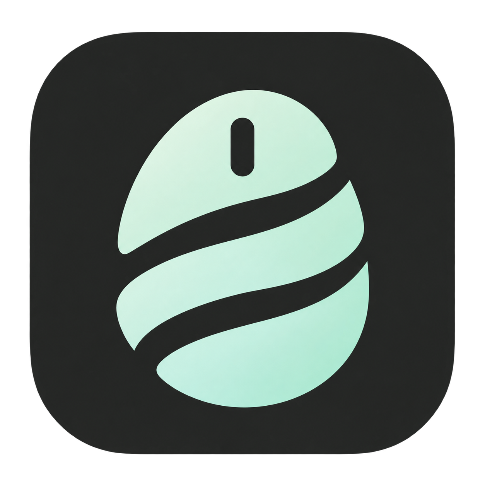

# weft

Share one mouse between your Mac and multiple Android devices.

一台 Mac 与多台 Android 设备共享鼠标。通过屏幕边缘、菜单栏或快捷键切换，各设备可以同时保持连接，同一时刻控制一台。



## 功能与要求

- Mac ↔ Android 双向自动跨屏，按屏幕尺寸与排列保持坐标连续。
- 每台设备独立设置位置、速度、自动连接和自动跨屏。
- 共享鼠标移动、五个按键和滚轮；不共享键盘、音视频或剪贴板。
- USB / 无线 ADB，不需要 root 或安装 Android APK。
- macOS 13 或更新版本，支持构建 Apple Silicon / Intel 通用包。
- 当前实机验证集中于 Android 16；其他版本和厂商需要单独验证。

运行时需单独安装 Android Platform Tools，并在 Android 上授权调试。首次运行，在“系统设置 → 隐私与安全性 → 辅助功能”中允许 weft。紧急返回 Mac：左侧 `Option` 或 `Esc`。

## 使用 Xcode

1. 安装 Xcode、JDK 17+、Android SDK Platform 36 和 Build Tools 36.0.0。
2. 双击 **`Weft.xcodeproj`**，选择 **Weft** scheme 和 **My Mac**。
3. `Command + B` 构建，`Command + R` 运行，`Product → Archive` 归档。

macOS 应用、图标、资源、版本和签名由 Xcode 管理，不需要 Python 或 XcodeGen。Android 控制程序由工程中的 `Build Android agent` 步骤自动编译并嵌入应用；生成文件保存在 Xcode 的 DerivedData 中。

Android SDK 默认位于 `~/Library/Android/sdk`。自定义位置可通过 `ANDROID_SDK_ROOT` 或 `ANDROID_HOME` 指定。JDK 使用 `JAVA_HOME`，未指定时通过 macOS `java_home` 查找。

Debug 默认使用 ad-hoc 签名，便于从源码构建；Release 使用 Developer ID Application。个人签名设置可放入不提交的 `Config/Signing.local.xcconfig`，内容示例：

```xcconfig
DEVELOPMENT_TEAM = YOUR_TEAM_ID
CODE_SIGN_IDENTITY[config=Release] = Developer ID Application: Your Name (YOUR_TEAM_ID)
```

## 命令行构建

```sh
xcodebuild -project Weft.xcodeproj -scheme Weft -configuration Debug \
  -destination 'platform=macOS,arch=arm64' \
  -derivedDataPath outputs/DerivedData build
```

上例适用于 Apple Silicon；Intel Mac 将 `arch=arm64` 替换为 `arch=x86_64`。应用位于 `outputs/DerivedData/Build/Products/Debug/weft.app`。

在 Xcode 中使用 `Command + U` 运行测试，或使用 `xcodebuild ... test`。普通 Build 和 Archive 不执行测试，也不操作实体设备。Android 主机检查可通过构建设置 `WEFT_ANDROID_TESTS=YES` 主动启用。

## GitHub 产物与正式发行

GitHub Actions 使用同一 Xcode 工程，运行主机检查并构建通用测试 ZIP。下载位置为 Actions 运行页面的 **Artifacts → weft-macos-universal-UNNOTARIZED**。测试包未经过 Apple 公证，正式发行使用本机 Developer ID 签名、公证后的 DMG。

- [使用说明与快捷键](docs/USAGE.zh-CN.md)
- [签名、公证和发布流程](docs/RELEASING.md)
- [验证范围与限制](docs/VERIFICATION.md)
- [MIT 许可证](LICENSE)

`Sources/WeftCore` 是坐标与布局逻辑，`Sources/Weft` 是 macOS 应用，`Android/src` 是 Android 控制程序。`Android/stubs` 仅用于编译，不嵌入控制程序。Android 和 macOS 控制包含非公开系统接口，系统升级与厂商差异可能影响兼容性。
